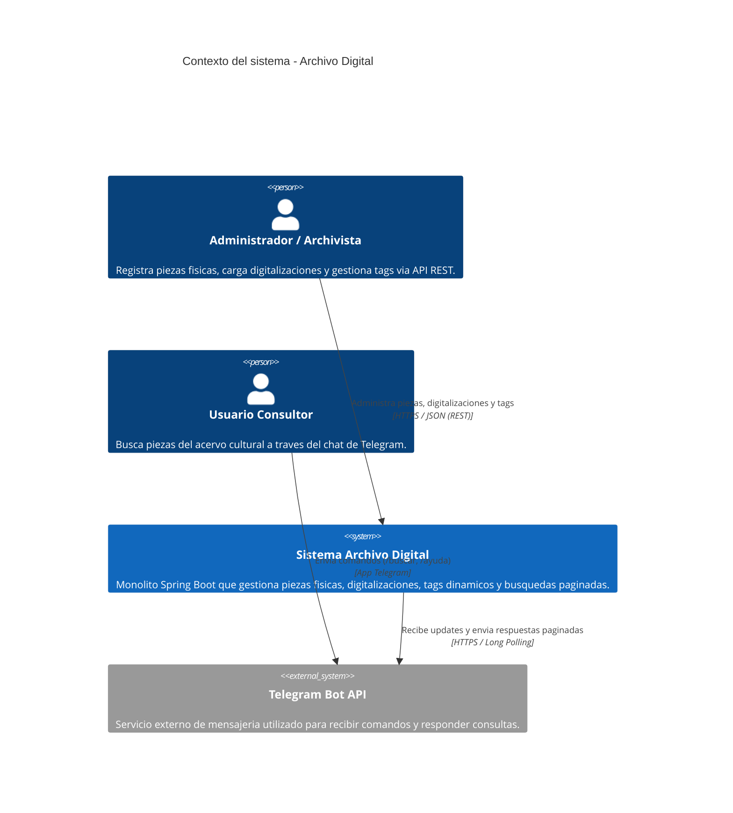
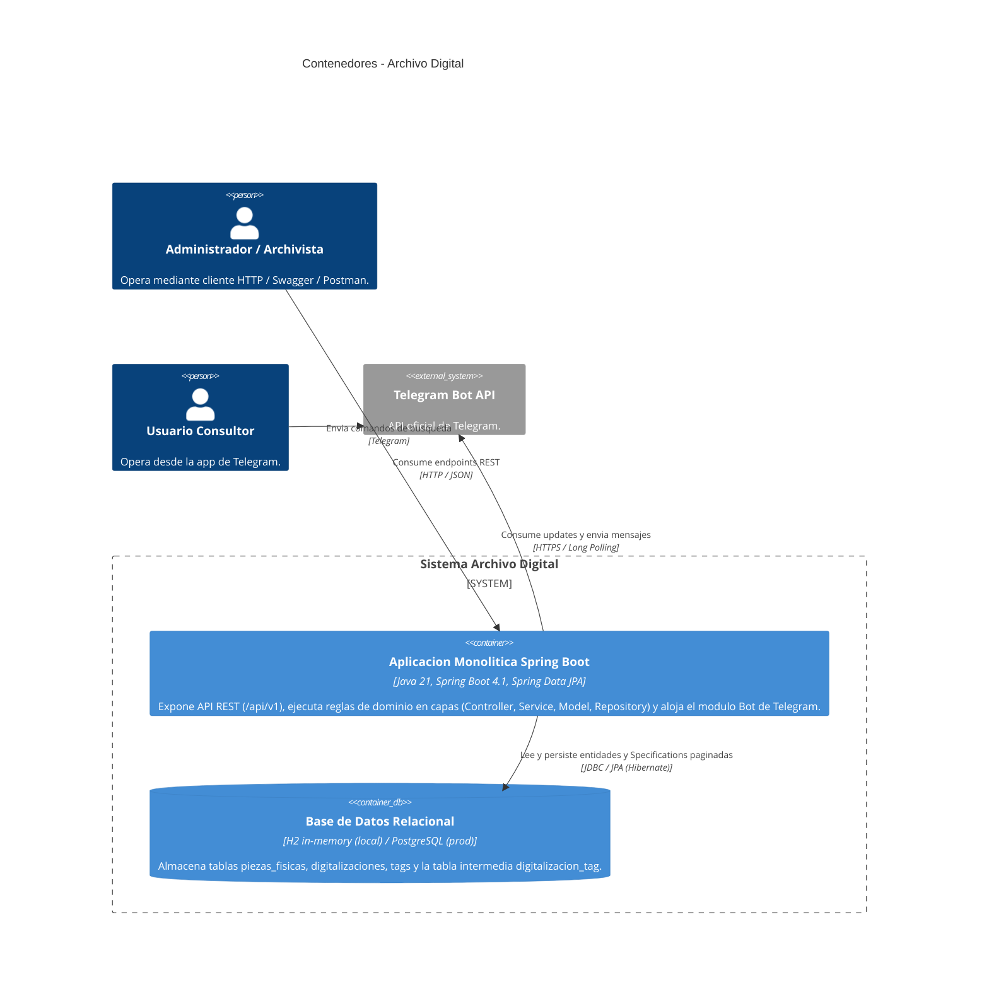
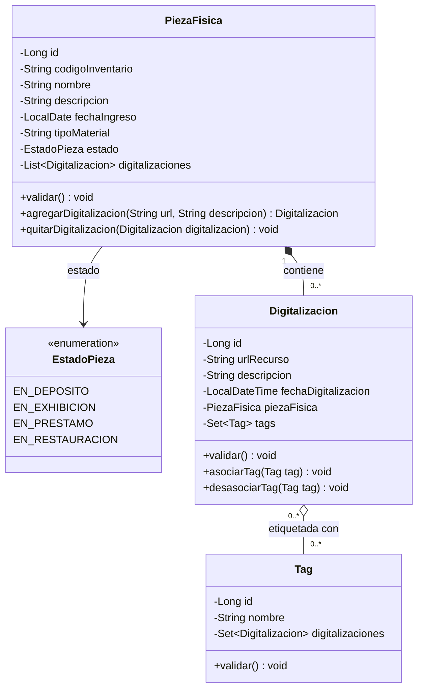

# ARCHITECTURE.md

Documento transversal (no cambia por feature/iteración). Complementa a [`AGENTS.md`](AGENTS.md)
(convenciones de código) con la descripción del dominio y la arquitectura general del sistema.

## 1. Descripción general

**Archivo Digital** es un sistema backend monolítico en capas (Java 21 + Spring Boot + Spring Data JPA) diseñado para gestionar el acervo patrimonial de una fundación cultural. Permite registrar **piezas físicas** (documentos, fotografías, mapas, libros, etc.), asociarles múltiples **digitalizaciones** (archivos digitales accesibles por URL HTTP/HTTPS), catalogarlas mediante **tags dinámicos** administrables en tiempo de ejecución y disponibilizar **búsquedas avanzadas paginadas** preparadas para gran volumen de datos, tanto por **API REST** (`/api/v1`) como a través de un **Bot de Telegram**.

## 2. Actores y sistemas

- **Administrador / Archivista:** Usuario interno de la fundación que opera sobre la API REST (`/api/v1`) para registrar piezas físicas, cargar digitalizaciones, crear o eliminar tags dinámicos y asociar tags a las digitalizaciones.
- **Usuario Consultor:** Usuario final (investigador o público general) que consulta el acervo cultural mediante comandos conversacionales en el Bot de Telegram (`/start`, `/ayuda`, `/buscar`).
- **Sistema Archivo Digital (Monolito Spring Boot):** Aplicación central que encapsula la lógica de negocio (módulos de Digitalización, Catalogación, Disponibilización y Bot de Telegram) y la persistencia relacional.
- **Telegram Bot API (Sistema externo):** Plataforma de mensajería con la que el módulo `bot` se comunica vía *Long Polling* (`telegrambots-springboot-longpolling-starter`) para recibir comandos y enviar resultados paginados.
- **Base de Datos Relacional (H2 / PostgreSQL):** Almacenamiento transaccional gestionado con JPA/Hibernate. Usa H2 en memoria en perfil `local` y PostgreSQL en perfiles `postgres` y `prod`.

## 3. Alcance y fuera de alcance

**Dentro de alcance:**
- Alta y consulta detallada de piezas físicas con control de unicidad de `codigoInventario` y validaciones de dominio/DTO.
- Carga y asociación de múltiples digitalizaciones por pieza física con validación de URLs HTTP/HTTPS.
- Gestión de tags dinámicos en tiempo de ejecución (`POST`, `GET`, `DELETE /api/v1/tags`) y asociación N:M a digitalizaciones (`POST /api/v1/digitalizaciones/{id}/tags`).
- Búsqueda avanzada paginada y ordenada determinísticamente de piezas físicas (`GET /api/v1/piezas-fisicas/buscar`) combinando término libre, rango de fechas y tag asociado a sus digitalizaciones.
- Canal de consulta mediante Bot de Telegram (`/start`, `/ayuda`, `/buscar <termino> [tag:<tag>] [p:<n>]`) activable por configuración (`telegram.bot.enabled`).
- Manejo centralizado de errores (`GlobalExceptionHandler`) con payload homogéneo `{"error": "..."}`.
- Perfiles de configuración para desarrollo local (H2) y entorno productivo (PostgreSQL).
- Pruebas unitarias (JUnit 5 + Mockito), pruebas de repositorio (`@DataJpaTest`), pruebas de integración E2E (`MockMvc`) y análisis estático (`Checkstyle`, `PMD`, `SpotBugs`).

**Fuera de alcance:**
- Desarrollo de un frontend web SPA complejo (la visualización al usuario final se resuelve mediante el Bot de Telegram y la API REST).
- Almacenamiento binario directo de archivos pesados en la base de datos (se almacenan URLs HTTP/HTTPS hacia recursos externos).
- Autenticación, autorización RBAC y gestión de usuarios/sesiones.
- Arquitectura distribuida de microservicios o colas de mensajería asincrónica.

## 4. Glosario de dominio

| Término | Significado |
|---|---|
| **Pieza Física (`PiezaFisica`)** | Bien cultural u objeto físico perteneciente al acervo de la fundación (fotografía, acta, mapa, libro). Es la raíz de agregado sobre la que se realizan las búsquedas. |
| **Código de Inventario** | Identificador alfanumérico único de una pieza física dentro del archivo (ej. `INV-2026-0042`), validado de forma *case-insensitive*. |
| **Estado de Pieza (`EstadoPieza`)** | Situación física actual de la pieza en la fundación: `EN_DEPOSITO` (por defecto), `EN_EXHIBICION`, `EN_PRESTAMO` o `EN_RESTAURACION`. |
| **Digitalización (`Digitalizacion`)** | Recurso digital (escaneo, fotografía en alta resolución, PDF) generado a partir de una pieza física y referenciado mediante una URL HTTP/HTTPS válida. |
| **Tag (`Tag`)** | Etiqueta libre y administrable en tiempo de ejecución (ej. `MANUSCRITO`, `RESTAURADO`, `FOTOGRAFIA`) usada para catalogar digitalizaciones y filtrar piezas físicas. |
| **Catalogación** | Proceso de crear/eliminar tags dinámicos y asociarlos a digitalizaciones existentes. |
| **Disponibilización** | Exposición de consultas paginadas de gran volumen sobre piezas físicas para clientes HTTP y el Bot de Telegram. |

## 5. Vista C4 — Contexto (Nivel 1)

## 6. Vista C4 — Contenedores (Nivel 2)

## 7. Diagrama de clases de dominio

## 8. Preguntas abiertas / próximos pasos

- **Integración final de ramas en `main`:** Unificar los últimos commits de mejora de PR #18 (`PaginaResponseDTO`, `ArchivoDigitalMapper`, `DELETE /api/v1/tags/{id}` y `ArchivoDigitalIntegracionTest`) con PR #19 (Bot de Telegram), adaptando `TelegramCommandDispatcher` y `TelegramMessageFormatter` al contrato estable `PaginaResponseDTO`.
- **Validación en PostgreSQL y despliegue en Render (Issue #12):** Probar el perfil `postgres` end-to-end contra una instancia real de PostgreSQL (incluyendo paginación con orden determinístico y `PiezaFisicaSpecifications`) y configurar las variables de entorno en Render.
- **Extras opcionales del backlog:** Evaluar el avance de carga masiva por CSV (Issue #9) e integración con APIs de terceros de OCR / etiquetado automático (Issue #10) según disponibilidad del equipo.

## 9. Referencias

- Convenciones de código y arquitectura por capas: [`AGENTS.md`](AGENTS.md).
- Backlog de issues y alcance por iteración: [`Backlog.md`](Backlog.md).
- Especificación de endpoints y contratos JSON: [`docs/api.md`](docs/api.md).
- Estrategia y plan de pruebas: [`docs/test.md`](docs/test.md).
- Diagramas complementarios (arquitectura, clases, DER y secuencias): [`docs/diagramas/`](docs/diagramas/README.md).
