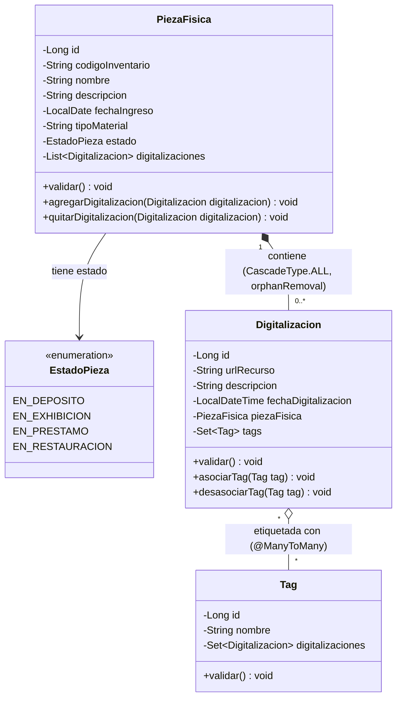
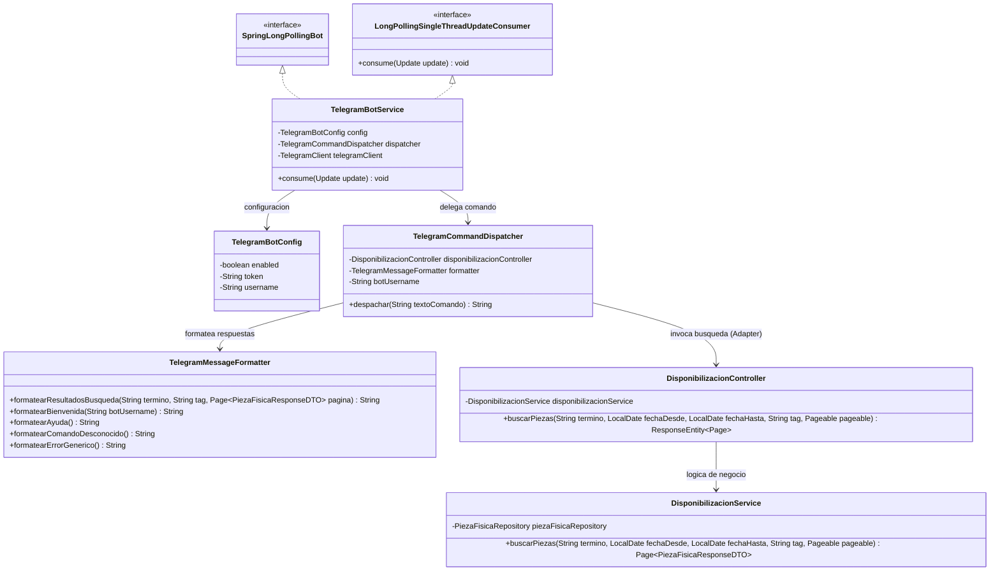

# Diagramas de Clases

Este documento contiene los **Diagramas de Clases** para el sistema **Archivo Digital** (TP Integrador - Diseño de Software UNSAM), cubriendo tanto el Modelo de Dominio como la Capa de Presentación del Bot de Telegram (Patrón Adapter).

---

## 1. Modelo de Dominio (Entidades de Negocio)

El dominio del sistema se compone de tres entidades principales y un enum que modelan el acervo cultural, sus archivos digitales y su catalogación mediante etiquetas dinámicas. Las entidades implementan un **Modelo de Dominio Rico**, protegiendo sus propias invariantes mediante validaciones y métodos de sincronización bidireccional.

---

## 2. Integración del Bot de Telegram (Patrón Adapter)

Para desacoplar el canal de mensajería del núcleo del negocio e intercambiar en el futuro Telegram por WhatsApp o interfaces web sin impacto, el módulo de Telegram se implementa como un **Adaptador de Presentación** que invoca directamente a la frontera del sistema (`DisponibilizacionController`), respetando la jerarquía de capas de Martin Fowler:

