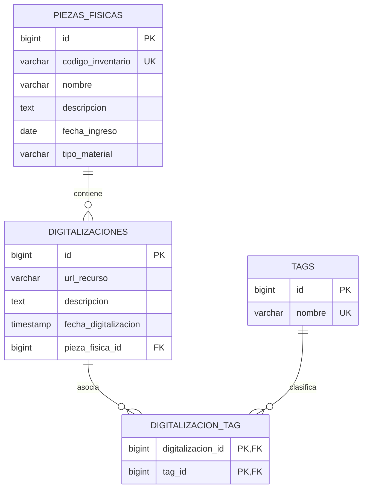

# Diagrama Entidad-Relación (DER)

Este documento detalla el modelo de datos relacional para el sistema **Archivo Digital**.

---

## 1. Diagrama Entidad-Relación (Mermaid)

---

## 2. Diccionario de Datos

### Tabla: `PIEZAS_FISICAS`
| Columna | Tipo | Nulo | Descripción |
|---|---|---|---|
| `id` | `BIGINT` | NO | Clave primaria autoincremental. |
| `codigo_inventario` | `VARCHAR(100)` | NO | Código único de inventario físico. |
| `nombre` | `VARCHAR(255)` | NO | Título de la pieza. |
| `descripcion` | `TEXT` | SÍ | Reseña o detalle histórico. |
| `fecha_ingreso` | `DATE` | NO | Fecha de ingreso a la fundación. |
| `tipo_material` | `VARCHAR(50)` | NO | Clasificación del material (ej. Fotografía, Documento). |

### Tabla: `DIGITALIZACIONES`
| Columna | Tipo | Nulo | Descripción |
|---|---|---|---|
| `id` | `BIGINT` | NO | Clave primaria autoincremental. |
| `url_recurso` | `VARCHAR(500)` | NO | Enlace o ruta al recurso digitalizado. |
| `descripcion` | `TEXT` | SÍ | Detalle del archivo digital. |
| `fecha_digitalizacion` | `TIMESTAMP` | NO | Momento en que se generó la digitalización. |
| `pieza_fisica_id` | `BIGINT` | NO | FK hacia `PIEZAS_FISICAS` (Relación 1 a N). |

### Tabla: `TAGS`
| Columna | Tipo | Nulo | Descripción |
|---|---|---|---|
| `id` | `BIGINT` | NO | Clave primaria autoincremental. |
| `nombre` | `VARCHAR(100)` | NO | Nombre único de la etiqueta gestionable en tiempo de ejecución. |

### Tabla intermedia: `DIGITALIZACION_TAG`
| Columna | Tipo | Nulo | Descripción |
|---|---|---|---|
| `digitalizacion_id` | `BIGINT` | NO | FK hacia `DIGITALIZACIONES`. |
| `tag_id` | `BIGINT` | NO | FK hacia `TAGS`. |