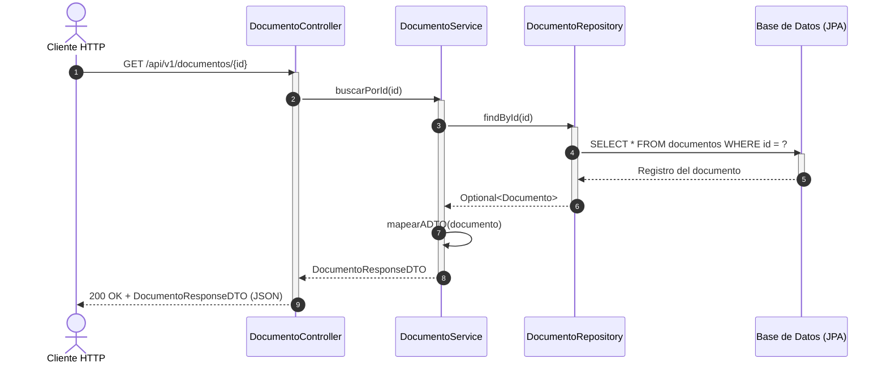
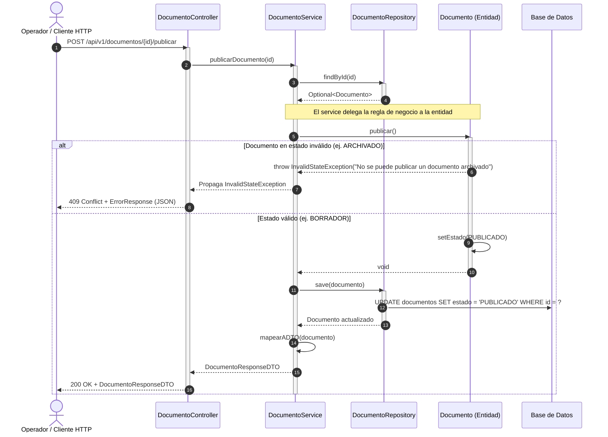
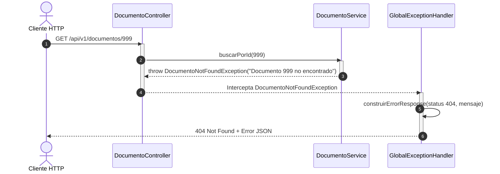

# Diagramas de Secuencia

Este documento ilustra las interacciones dinámicas y el flujo de llamadas entre capas para los casos de uso principales del sistema **Archivo Digital**.

---

## 1. Caso de Uso: Consulta de Recurso por ID (Flujo Exitoso)

Muestra la propagación de una solicitud GET desde el cliente HTTP hasta la base de datos y la transformación a DTO.

---

## 2. Caso de Uso: Transición de Estado con Validación de Invariante de Dominio

Ilustra la invocación de un método de negocio sobre la entidad rica, asegurando que las reglas del negocio vivan en el modelo y no en el servicio.

---

## 3. Caso de Uso: Manejo de Excepción (Recurso No Encontrado)

Muestra la captura homogénea mediante `@RestControllerAdvice` (`GlobalExceptionHandler`).

