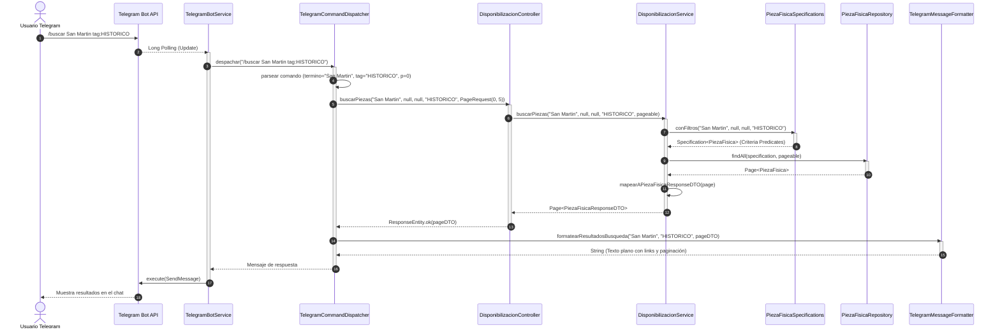
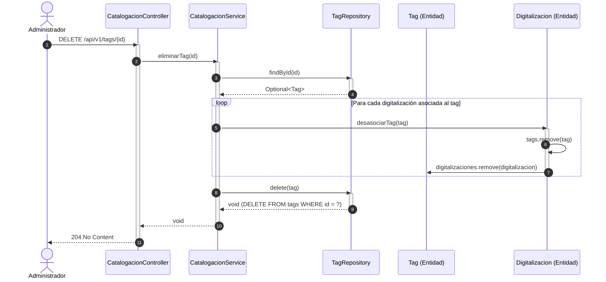
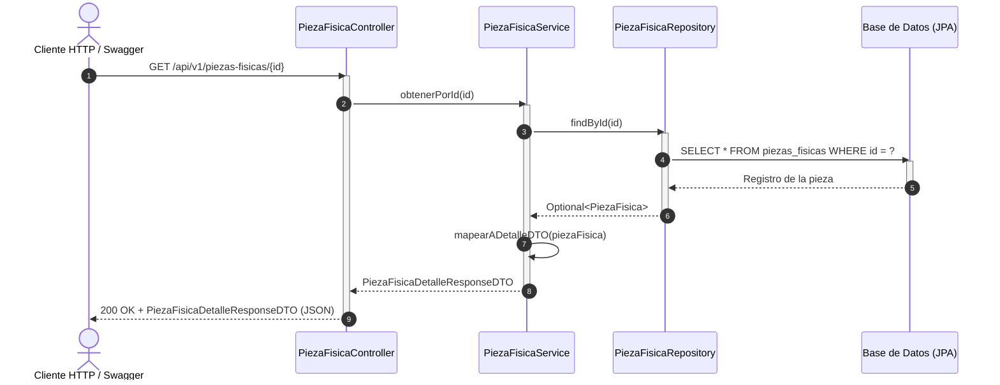
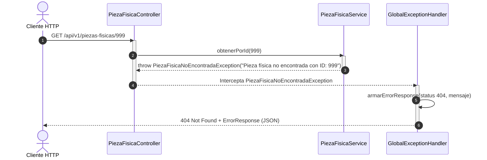

# Diagramas de Secuencia

Este documento ilustra las interacciones dinámicas y el flujo de llamadas entre capas para los casos de uso principales del sistema **Archivo Digital** (TP Integrador - Diseño de Software UNSAM).

---

## 1. Caso de Uso: Búsqueda Avanzada desde el Bot de Telegram (Patrón Adapter)

Muestra el flujo conversacional donde el usuario busca piezas desde Telegram (`/buscar San Martin tag:HISTORICO`). El bot procesa el mensaje como un adaptador de presentación e invoca a `DisponibilizacionController`:

---

## 2. Caso de Uso: Eliminación Segura de un Tag del Catálogo

Ilustra la administración del catálogo de tags en tiempo de ejecución. Para no violar la clave foránea en la tabla intermedia `digitalizacion_tag`, el servicio desasocia primero las digitalizaciones antes de eliminar el tag:

---

## 3. Caso de Uso: Consulta de Pieza Física por ID con Digitalizaciones (Flujo Exitoso)

Muestra la propagación de una solicitud GET desde el cliente HTTP hasta la base de datos y la transformación a DTO enriquecido:

---

## 4. Caso de Uso: Manejo Global de Excepción (Recurso No Encontrado)

Muestra la captura homogénea mediante `@RestControllerAdvice` (`GlobalExceptionHandler`):

